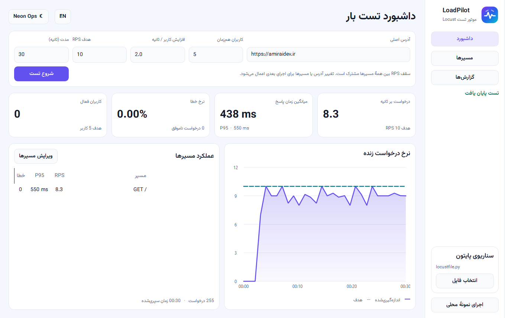
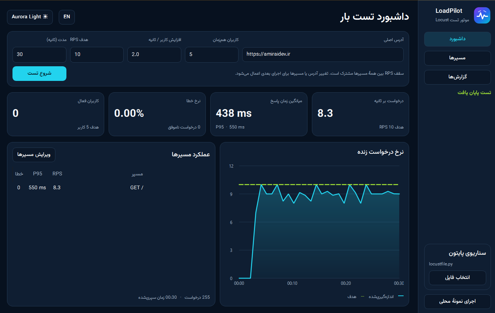
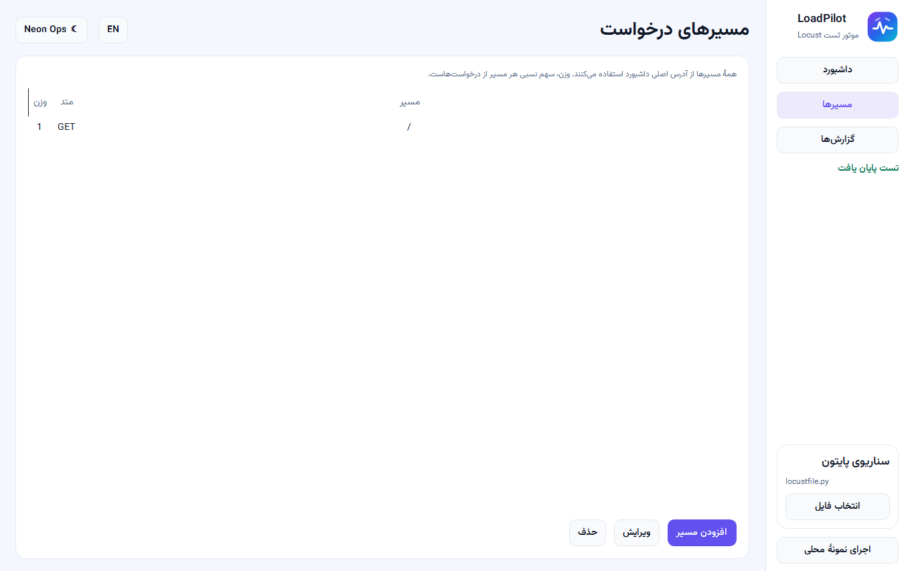
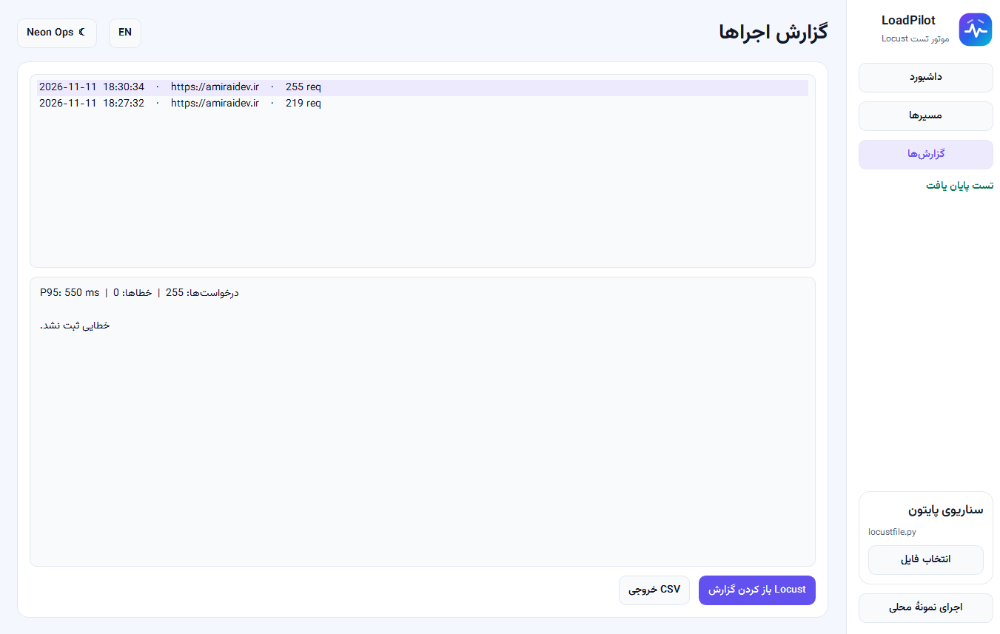

# LoadPilot

LoadPilot یک برنامهٔ دسکتاپ برای تست بار وب‌سایت‌ها و APIها با موتور Locust است. نسخهٔ ویندوز ۶۴ بیتی مستقیماً از فایل اجرایی باز می‌شود.

**[دانلود LoadPilot.exe](../../releases/latest/download/LoadPilot.exe)**

## امکانات

- تعریف چند مسیر `GET` و `POST` روی یک سایت و تنظیم تعداد کاربران و سقف درخواست بر ثانیه (RPS)
- نمایش زندهٔ نرخ درخواست، زمان پاسخ و خطاها، همراه با گزارش HTML و خروجی CSV
- اجرای سناریوی سفارشی از فایل `locustfile.py`
- رابط فارسی و انگلیسی با تم روشن **Aurora Light** و تم تیرهٔ **Neon Ops**

## شروع سریع

فایل `LoadPilot.exe` را باز کنید و روی **اجرای نمونهٔ محلی** بزنید. برای تست سرویس خود، آدرس اصلی و مسیرها را وارد کنید و **شروع تست** را بزنید.

تصاویر بیشتر از برنامه

